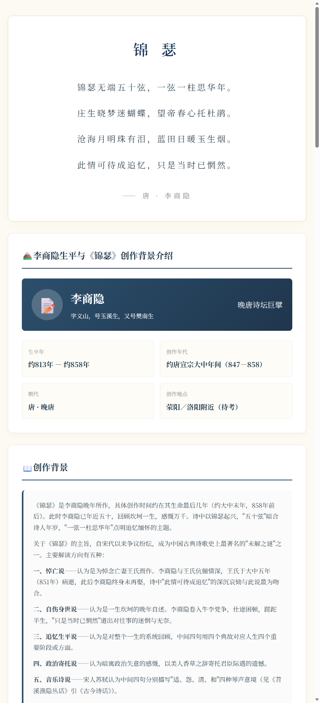

# 每日诗歌推荐 Daily Poetry Recommendation 📜

一个**开箱即用的 Skill 模板**：让 AI 每天推荐一首古代著名诗歌，生成**严谨精美的 HTML 深度解读页**（新中式文雅山水风）——诗人背景、创作背景、情感曲线、逐句赏析、艺术特色、历代评价，一页读懂一首诗。

> 每日一诗 · 与古人对话

---

## ✨ 特性

- 📜 **每日一诗**：自动推荐古代经典诗歌（唐诗宋词等），自动去重
- 🏔️ **诗人与背景**：诗人卡片、创作背景、时代背景
- 📊 **情感曲线**：三阶段情感变化图示（晚霞金 / 竹青 / 暮色灰蓝）
- 📖 **逐句深度解读**：字面意思 + 修辞手法 + 深度解读，一句不落
- 💎 **千古名句**：至今仍被广泛引用的名句集锦
- 📚 **历代评价**：注明出处的历代评家观点（朝代 + 评家姓名）
- 🎨 **新中式配色**：宣纸白底、黛蓝渐变、意境配色表（绝不使用科技蓝）
- ⚙️ **可接入自动化**：配置为每日/每周定时任务自动执行

## 🖼️ 效果预览

<p align="center">
  
</p>

> 完整 HTML 示例见 [examples/](examples/)：

| 示例 | 诗歌 | 作者 | 推送日期 |
|------|------|------|----------|
| [2026-06-20](examples/2026-06-20-manjianghong.html) | 满江红·怒发冲冠 | 岳飞 | 2026-06-20 |
| [2026-06-23](examples/2026-06-23-jinse.html) | 锦瑟 | 李商隐 | 2026-06-23 |

## 📦 安装方法

### 方式一：直接把链接丢给 AI Agent（小白最推荐 🌟）

**什么都不用自己操作**，只需把下面这段话复制给你的 AI 助手（WorkBuddy / Codex / Claude 等），让它自己去下载、安装，再教你怎么用：

> 请帮我把这个 GitHub 仓库的 Skill 安装好：
> 仓库：https://github.com/fang-123559/daily-poetry-recommendation
> 请先下载（git clone 或下载 ZIP），把 `daily-poetry-recommendation` 文件夹放到我的 skills 目录
> （WorkBuddy: `~/.workbuddy/skills/`，Codex: `~/.codex/skills/`，Claude: `~/.claude/skills/`），
> 确认 `SKILL.md` 在文件夹根目录，然后告诉我怎么用它。

### 方式二：手动下载（推荐新手）

1. 点击右上角 **Code → Download ZIP** 下载并解压
2. 将解压后的文件夹放入你的 Skill 目录：
   - **WorkBuddy**：`~/.workbuddy/skills/`
   - **Codex**：`~/.codex/skills/`
   - **Claude**：`~/.claude/skills/`
   - 其他支持 Agent Skills 的平台：放入对应 skills 目录
3. 确保文件夹名为 `daily-poetry-recommendation`，且 `SKILL.md` 在文件夹根目录

### 方式三：Git 克隆

```bash
git clone https://github.com/fang-123559/daily-poetry-recommendation.git
# 然后将整个文件夹复制到 skills 目录
```

## 🚀 使用方式

### 方式一：对话中直接触发

> "每日诗歌推荐"、"推荐一首诗"、"今日诗词"

### 方式二：接入自动化定时推送（推荐）

在 WorkBuddy / Codex / Claude 等平台创建一个定时任务（每周二/四/六），prompt 可参考 [prompts/automation-prompt.md](prompts/automation-prompt.md)。

首次使用请初始化 `history.json` 为空数组 `[]`。

## 🗂️ 项目结构

```
daily-poetry-recommendation/
├── SKILL.md                      # Skill 核心定义（执行流程 + 配色规范 + 异常处理）
├── README.md                     # 本文件
├── LICENSE                       # MIT 许可证
├── prompts/
│   └── automation-prompt.md      # 自动化定时任务的 prompt 模板
├── templates/
│   └── poem-template.html        # 诗歌深度解读 HTML 模板
└── examples/                     # 完整输出示例（深度解读 HTML）
```

## ⚙️ 自定义

- **改配色**：修改模板中的 CSS 变量和意境配色表
- **改模块结构**：增删模板中的 section 区块
- **改触发场景**：修改 SKILL.md frontmatter 中的 `description` 触发词

## 📜 License

[MIT](LICENSE) © fang-123559

---

<p align="center"><b>每日一诗 · 与古人对话</b> 📜</p>
